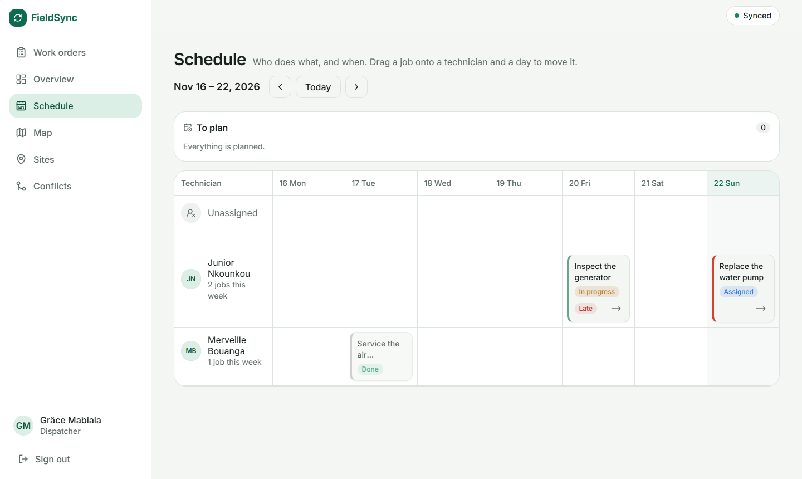
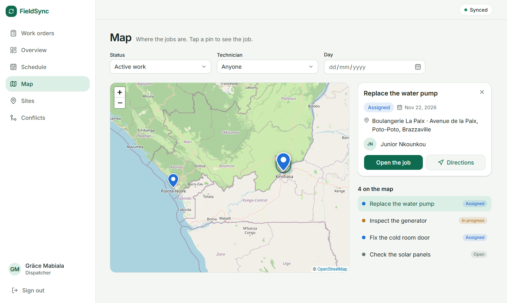
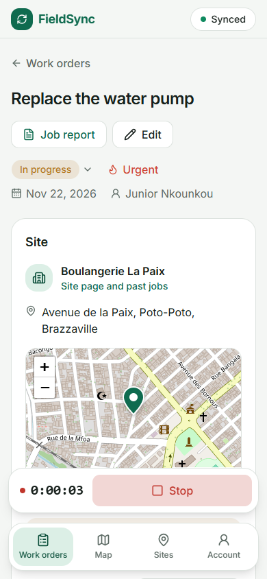
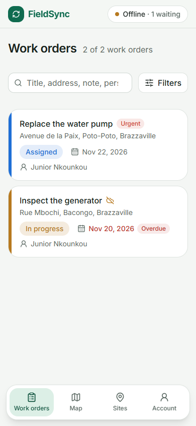
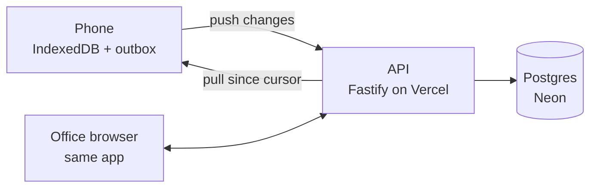

# FieldSync

[](https://github.com/chrismoussounda/fieldsync/actions/workflows/ci.yml)

Work orders for field teams that keep working without a signal. The office
plans the jobs; technicians get them on their phone, work through the
checklist, record their time, parts and photos and get the customer's
signature, all offline. Every change syncs as soon as the network is back,
and when two people edit the same thing, the latest wins and the office can
review what was overwritten.

**Live demo:** [fieldsync-iota.vercel.app](https://fieldsync-iota.vercel.app). On the sign-in page, try it **as the office** or **as a technician**, no account needed. The demo starts over every night.

| Office: the week's schedule                | Office: the jobs on a map        |
| ------------------------------------------ | -------------------------------- |
|  |  |

| Technician: on site, clock running                                                                     | Technician: working offline                                                                                      |
| ------------------------------------------------------------------------------------------------------ | ---------------------------------------------------------------------------------------------------------------- |
|  |  |

## Features

- **Offline first**: the app installs on the phone, opens without a network, and every change is saved on the device before it is sent
- **A hand-built sync engine**: per-field last-writer-wins with hybrid logical clocks, idempotent pushes, cursor-based pulls and a conflict log for the office ([how it works](docs/sync-engine.md), [protocol](docs/protocol.md))
- **Each technician syncs only their own jobs**, and gets a job's whole history when it is assigned to them
- **Schedule board**: drag jobs onto a technician and a day, with undo
- **Map**: every job as a pin coloured by status, directions to the exact door
- **On site**: checklist, time on site, parts and materials, photos, the customer's signature, and a printable job report
- **Teams and roles**: technicians, dispatchers and admins; an admin can lock out a lost phone
- French and English, light and dark, from phone to desktop

## How it works



Each device keeps its own copy of the data and a queue of changes. Syncing
sends the queue, then pulls what changed since the last cursor; the server
merges each field by its clock, so the result is the same in whatever order
devices come back online. The rules live in shared packages, tested on their
own and by a simulator that plays hundreds of random offline sessions between devices and checks they all end up the same.

## Stack

React 19 · Vite · TypeScript · Tailwind v4 + shadcn/ui on React Aria ·
TanStack Router, Query, Table and Form · Dexie (IndexedDB) · Leaflet + OpenStreetMap ·
Fastify · Postgres + Kysely · Vitest · Playwright · GitHub Actions · Vercel + Neon

```
apps/web               the app, for phones and the office
apps/api               the server
packages/hlc           hybrid logical clocks
packages/merge         per-field merge and conflict detection
packages/protocol      the messages devices and server exchange
packages/sync-client   the device side of sync
packages/work-orders   the rules for jobs, sites, photos, roles
packages/sim           the offline simulator
```

## Run it locally

Requires Node 22+, [pnpm](https://pnpm.io) and Docker.

```bash
docker compose up -d                        # local Postgres
pnpm install
cp apps/api/.env.example apps/api/.env      # then set JWT_SECRET and DEMO_PASSWORD
pnpm --filter @fieldsync/api dev            # API on :3000, creates the demo data
pnpm --filter @fieldsync/web dev            # app on :5173
```

Tests: `pnpm test` (unit), `pnpm test:integration`, `pnpm test:e2e` (Playwright, starts its own Postgres in Docker).

## Deploy

Everything runs on free plans, the web app and the API as one Vercel project,
the database on Neon: see [docs/deploy.md](docs/deploy.md).

## License

[MIT](LICENSE)
