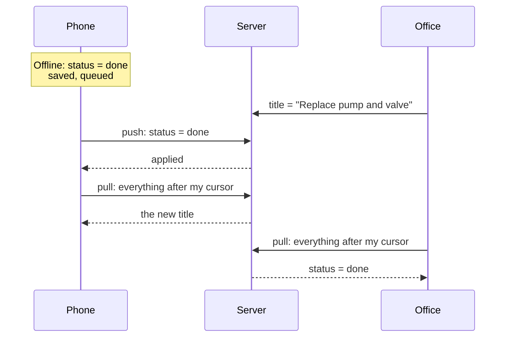

# How the sync engine works

A technician fixes a pump in a basement with no signal. Meanwhile the office
renames the same job and moves it to another day. The technician's phone clock
is ten minutes fast. When the phone reconnects, the request arrives but its
answer is lost, so the phone sends everything again.

FieldSync has to end with one version of that job, the same on every device,
with nobody's work silently lost. This is how it does it, without a sync
library. The exact rules and messages are in the [protocol](protocol.md); this
page is about the problems and why each choice was made.

## The shape of it

Each device has its own copy of the data and an **outbox**, a queue of changes
not yet sent. Every change is written to both in one step, so the app never
waits for the network and closing it loses nothing.



A sync is always a **push** of the outbox, then a **pull** of what changed
since last time. The same merge function runs on the phone and on the server.

## Problem 1: which edit is the latest?

Asking each phone for the time is not enough: clocks are wrong, and a clock
set back would make a new edit look old.

Changes are stamped with a **hybrid logical clock** instead: the time, plus a
counter, plus the device's id.

```
0193a5c2f1e00-0003-0a1b2c3d
time          count device
```

- The time never goes backwards. If the phone's clock does, the stamp keeps its
  last time and the counter goes up.
- Seeing someone else's stamp moves your own past it, so an edit made after
  reading another always sorts after it.
- The device id breaks ties, so no two stamps are ever equal.
- It is fixed-width text, so comparing two stamps is comparing two strings, in
  TypeScript and in Postgres alike.

One phone set to next year would otherwise win every edit and drag the others
along. So a device ignores stamps more than 24 hours ahead, the server refuses
them, and devices correct their time from the server's at every contact.
Changes stamped before that first contact are re-stamped and sent again, rather
than lost.

Code: [`packages/hlc`](../packages/hlc/src/clock.ts), about 60 lines.

## Problem 2: two people edit the same job

Keeping the latest version of the whole job would throw away the office's new
title because the technician changed the status a second later. So the merge
works **field by field**: each field remembers the stamp of the write that set
it, and a later stamp wins.

| Field  | Office           | Technician               | Result                                       |
| ------ | ---------------- | ------------------------ | -------------------------------------------- |
| title  | `Pump and valve` | not touched              | `Pump and valve`                             |
| status | not touched      | `done`                   | `done`                                       |
| notes  | `Bring a ladder` | `Ladder on site` (later) | `Ladder on site`, and a conflict is recorded |

Only the last row is a real clash. The later note wins, and the earlier one
goes to the conflict log, where the office sees who wrote what. Each change
carries the stamps its author had seen (`base`), which is how the server tells
"replaced on purpose" from "never saw it". Two people choosing the same value
is agreement, not a conflict.

Lists, such as a checklist, are not a field. Each step is its own record, so
two people adding steps never overwrite each other.

The merge is one pure function, and **the order does not matter**: the same
changes applied in any order, or twice, give the same result. That is why
fields are merged even on a deleted record. Skipping them would make the result
depend on whether the edit or the delete arrived first.

Code: [`packages/merge`](../packages/merge/src/merge.ts), about 100 lines.

## Problem 3: the answer got lost

A phone that never hears back cannot know whether the server applied its
changes. It sends them again. Each change has a unique id and the server keeps
the result it gave for each, so a repeat gets the first answer and changes
nothing.

The batch is one database transaction: all of it is applied, or none.

## Problem 4: a change that slips past

A device pulls "everything after number 41". The obvious way to number changes,
a database sequence, has a trap: two pushes can take 41 and 42, and 42 can be
saved first. A phone pulling in between sees 42, moves on, and **never receives
41**. Nothing fails; one job is just wrong on one phone.

So the counter is a column on the organisation's row, and a push locks that row
first. Numbers are handed out in the order changes are saved. The cost is one
writer at a time per organisation, which is nothing at this scale. A test with
20 devices pushing at once checks it, and fails if the counter is swapped for a
sequence.

## Problem 5: each technician's share

A technician's phone should hold only their jobs. The hard part is a job that
moves: one assigned today has a history the phone never received, and one taken
away has to disappear.

Each change therefore records whose job it was before and after. To someone it
now belongs to, the server sends the whole job as it is (`enter`). To someone
it no longer belongs to, it says to drop it (`leave`). Photos and checklist
steps follow their job.

An edit made offline on a job that was taken away in the meantime is refused,
and the phone rebuilds from the server's copy, so it never keeps showing
something the server rejected.

## Does it work?

Examples written by hand only cover what their author thought of. Two other
kinds of test cover the rest.

**Property tests** check the merge on random changes: any order, any repeats,
same result.

**A simulator** plays whole sessions: 2 to 5 devices running the real client,
with clocks up to two days wrong that jump while running, on a network that
drops, loses answers after the server acted, and delivers old requests late.
Devices edit, delete, restore and reassign jobs. Then the network heals, and
every device must hold exactly what the server says it should see. It runs 500
random sessions in memory and 50 against real Postgres, and shrinks any failure
to the shortest session that still fails.

Code: [`packages/sim`](../packages/sim/src/world.ts).

## What it does not do

- **Merge text.** Two people rewriting the same note: the later one wins and
  the other is in the conflict log. Work orders are short fields, and a dispatcher
  reading the log is simpler than a text-merging algorithm (a CRDT).
- **Sync device to device.** Everything goes through the server.
- **Push in real time.** Devices ask every 15 seconds, and when the network
  comes back. That needs no open connection, so the server can run on a free
  plan.
